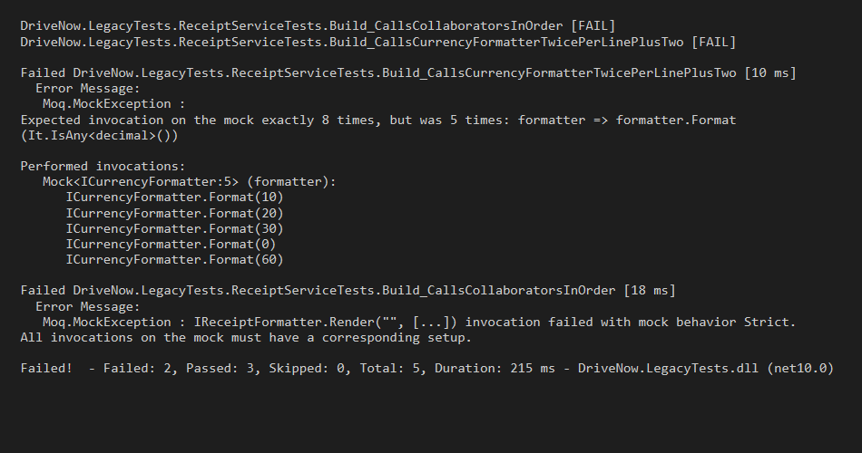
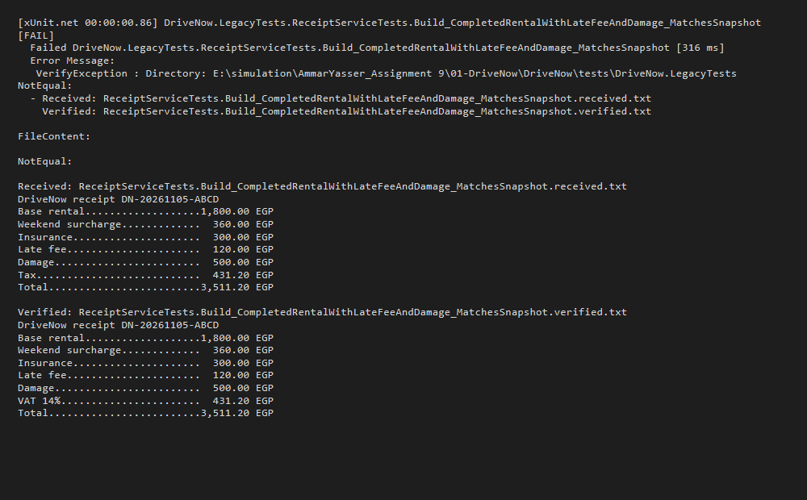

# Mocking & Legacy Tests Analysis (Task 8)
- **Name**: Ammar Yasser
- **Group / ID**: Backend .NET - Cycle 1

## R1 - Initial Assessment of What Legacy Tests Protect

When reading `ReceiptServiceTests.cs` before making any changes, the 5 tests appear to verify that `ReceiptService.Build` coordinates its four collaborators (`ILineItemFactory`, `ITaxCalculator`, `ICurrencyFormatter`, and `IReceiptFormatter`) in an orchestrated sequence:

1. **`Build_CallsLineItemFactoryOnce`**: Confirms that line items for the booking and return report are retrieved once from the factory.
2. **`Build_CallsTaxCalculatorOncePerLine`**: Confirms that VAT is calculated for every line item generated.
3. **`Build_CallsCurrencyFormatterTwicePerLinePlusTwo`**: Confirms that currency formatting is invoked for every line amount (twice: once during column width calculation and once during line assembly) plus once for the VAT amount and once for the total.
4. **`Build_CallsCollaboratorsInOrder`**: Enforces strict chronological invocation order across all dependencies using `MockSequence` and `MockBehavior.Strict`.
5. **`Build_ReturnsWhatTheRendererReturns`**: Confirms that `Build` returns the final rendered string output directly from `IReceiptFormatter.Render`.

At first glance, one might assume these tests protect the receipt generation workflow from skipping steps, miscalculating tax triggers, or dropping formatted fields.

## R2 - Refactoring `ReceiptService.Build` & Output Comparison

In `ReceiptService.Build`, `_currency.Format(item.Amount)` was originally called twice per item: once in an initial loop to calculate column padding width, and a second time in a subsequent loop to format line items.

We refactored this to format each item amount once, store the formatted strings in a list of tuples, and reuse the pre-formatted values:

```csharp
var total = net + vat;
var formattedItems = new List<(string Description, string FormattedAmount)>();
var width = 0;
foreach (var item in items)
{
    var formatted = _currency.Format(item.Amount);
    formattedItems.Add((item.Description, formatted));
    width = Math.Max(width, formatted.Length);
}

var lines = new List<string>();
foreach (var (description, formattedAmount) in formattedItems)
{
    lines.Add(description.PadRight(30, '.') + formattedAmount.PadLeft(width));
}

lines.Add("VAT 14%".PadRight(30, '.') + _currency.Format(vat).PadLeft(width));
lines.Add("Total".PadRight(30, '.') + _currency.Format(total).PadLeft(width));
return _receipts.Render(booking.Reference, lines);
```

### Console Output Comparison

**Before Refactor:**
```text
DriveNow receipt DN-20261105-ABCD
Base rental...................1,800.00 EGP
Weekend surcharge...............360.00 EGP
Insurance.......................300.00 EGP
Late fee........................120.00 EGP
Damage..........................500.00 EGP
VAT 14%.........................431.20 EGP
Total.........................3,511.20 EGP
```

**After Refactor:**
```text
DriveNow receipt DN-20261105-ABCD
Base rental...................1,800.00 EGP
Weekend surcharge...............360.00 EGP
Insurance.......................300.00 EGP
Late fee........................120.00 EGP
Damage..........................500.00 EGP
VAT 14%.........................431.20 EGP
Total.........................3,511.20 EGP
```

The output text, numbers, layout, and observable behavior are 100% identical.

---

## R3 - Legacy Test Failure & Screenshot

When running `dotnet test tests/DriveNow.LegacyTests` after the refactor, 2 of the 5 legacy tests failed immediately:



### Console Failure Output:
```text
[xUnit.net 00:00:00.56] DriveNow.LegacyTests.ReceiptServiceTests.Build_CallsCollaboratorsInOrder [FAIL]
[xUnit.net 00:00:00.59] DriveNow.LegacyTests.ReceiptServiceTests.Build_CallsCurrencyFormatterTwicePerLinePlusTwo [FAIL]

Failed DriveNow.LegacyTests.ReceiptServiceTests.Build_CallsCurrencyFormatterTwicePerLinePlusTwo [10 ms]
  Error Message:
   Moq.MockException : 
Expected invocation on the mock exactly 8 times, but was 5 times: formatter => formatter.Format(It.IsAny<decimal>())

Performed invocations:
   Mock<ICurrencyFormatter:5> (formatter):
      ICurrencyFormatter.Format(10)
      ICurrencyFormatter.Format(20)
      ICurrencyFormatter.Format(30)
      ICurrencyFormatter.Format(0)
      ICurrencyFormatter.Format(60)

Failed DriveNow.LegacyTests.ReceiptServiceTests.Build_CallsCollaboratorsInOrder [18 ms]
  Error Message:
   Moq.MockException : IReceiptFormatter.Render("", [...]) invocation failed with mock behavior Strict.
All invocations on the mock must have a corresponding setup.

Failed!  - Failed: 2, Passed: 3, Skipped: 0, Total: 5, Duration: 215 ms - DriveNow.LegacyTests.dll (net10.0)
```

---

## R4 - Analysis of Legacy Test Brittleness

### 1. What did these tests actually check?
They did not test observable behavior, correct receipt layout, or financial totals at all. Instead, they inspected **private implementation details**:
- Exactly how many times private loops called external interfaces (`Times.Exactly(8)`).
- The exact chronological sequence of intermediate method invocations using `MockSequence` and `MockBehavior.Strict`.
- Whether `Build` blindly returned the exact mocked return value of `IReceiptFormatter.Render`.

### 2. Why did a change with no behaviour change break them?
The refactor simply eliminated redundant string formatting calls by caching pre-formatted values. The output receipt remained identical byte-for-byte. However, because the legacy tests had hard-coded expectations on internal loop counts:
- `Build_CallsCurrencyFormatterTwicePerLinePlusTwo` failed because `Format` was invoked 5 times instead of the rigid expectation of 8 times.
- `Build_CallsCollaboratorsInOrder` failed because the strict sequence expected 8 sequential calls to `ICurrencyFormatter` before `IReceiptFormatter.Render`, so encountering `Render` after only 5 formatting calls violated the mock sequence setup.

This is a textbook example of **mock-heavy brittle tests**: they tie the test suite to private implementation details, punishing innocent optimizations and making refactoring perilous.

### 3. Would they catch a wrong VAT amount?
**No, absolutely not.**
In `ReceiptServiceTests.cs`, the test stubs `ITaxCalculator.CalculateVat` to always return `0m`:
```csharp
tax.Setup(calculator => calculator.CalculateVat(It.IsAny<decimal>())).Returns(0m);
```
The test only verifies that `CalculateVat` was called 3 times (`Times.Exactly(3)`). If `TaxCalculator` had a critical bug that calculated VAT at 100% or negative rates, or if `ReceiptService` added VAT incorrectly, these tests would still pass with flying colors. Furthermore, `Build_ReturnsWhatTheRendererReturns` merely asserts `result.Should().Be("RECEIPT")` based on mock returns, completely blind to the actual text content.

### 4. Which of the 4 interfaces exist only so they could be mocked?
All 4 interfaces (`ILineItemFactory`, `ITaxCalculator`, `ICurrencyFormatter`, and `IReceiptFormatter`) exist almost exclusively to enable mocking:
- **`ITaxCalculator`**: Contains a single trivial formula: `amount * 0.14m`. There is no other tax rule, no alternate tax system, and no I/O.
- **`ICurrencyFormatter`**: Formats numbers into Egyptian Pounds (`amount.ToString("#,##0.00", CultureInfo.InvariantCulture) + " EGP"`). No second currency exists in the domain.
- **`IReceiptFormatter`**: Concatenates a list of strings with `Environment.NewLine`.
- **`ILineItemFactory`**: Transforms a `Booking` and optional `ReturnReport` into an in-memory list of `LineItem` records.

None of these collaborators perform file I/O, database queries, or network calls. They are pure deterministic functions. Wrapping them in interfaces provided zero architectural polymorphism or decoupling benefits; it served only to allow Moq to mock them, resulting in over-engineered production code and fragile tests.

---

## R5 - Replacing Brittle Tests with Real Collaborators & Snapshot Testing

We replaced the 5 mock-heavy tests with clean tests that instantiate the real collaborators (`LineItemFactory`, `TaxCalculator`, `CurrencyFormatter`, `ReceiptFormatter`):

1. **`Build_CompletedRentalWithLateFeeAndDamage_MatchesSnapshot`**:
   Generates a full receipt for a completed 3-day rental with weekend surcharge, insurance, late return fee (120 EGP), and damage charges (500 EGP). The rendered receipt text is snapshot-tested using `Verify.Xunit`:
   ```csharp
   [Fact]
   public async Task Build_CompletedRentalWithLateFeeAndDamage_MatchesSnapshot()
   {
       var sut = new ReceiptService(
           new LineItemFactory(),
           new TaxCalculator(),
           new CurrencyFormatter(),
           new ReceiptFormatter());

       var booking = new Booking
       {
           Id = 1,
           Reference = "DN-20261105-ABCD",
           Price = new PriceBreakdown
           {
               RentalDays = 3,
               BaseAmount = 1800m,
               WeekendSurcharge = 360m,
               InsuranceCost = 300m,
               Total = 2460m
           }
       };

       var report = new ReturnReport
       {
           LateMinutes = 120,
           LateFee = 120m,
           DamageCharge = 500m
       };

       var receipt = sut.Build(booking, report);
       await Verify(receipt);
   }
   ```

2. **`Build_ValidLineItems_CalculatesAccurateVatAndTotal`**:
   Validates that the real `TaxCalculator` correctly computes 14% VAT (140.00 EGP on 1,000.00 EGP base) and includes it in the total (1,140.00 EGP), directly addressing the flaw where the legacy tests completely ignored tax amounts.

---

## R6 - Deliberate Label Change & Snapshot Diff

To verify that the snapshot test reliably detects unintended textual changes, we deliberately modified the VAT line label in `ReceiptService.Build`:
```csharp
// Deliberate change to verify snapshot detection:
lines.Add("Tax".PadRight(30, '.') + _currency.Format(vat).PadLeft(width));
```

Running `dotnet test tests/DriveNow.LegacyTests` failed immediately with a clear diff highlighting the discrepancy:



```text
NotEqual:
Received:
Tax...........................  431.20 EGP

Verified:
VAT 14%.......................  431.20 EGP
```

After capturing the diff, we reverted the label back to `"VAT 14%"`. The snapshot test passed cleanly once again.

---

## R7 - Removing Unnecessary Interfaces

We removed all four interfaces from `DriveNow.Application/Receipts`:
- `ILineItemFactory.cs` (Removed)
- `ITaxCalculator.cs` (Removed)
- `ICurrencyFormatter.cs` (Removed)
- `IReceiptFormatter.cs` (Removed)

### Justification:
1. **Zero Polymorphism**: Each interface had only one single implementation (`LineItemFactory`, `TaxCalculator`, `CurrencyFormatter`, `ReceiptFormatter`). None of them had alternate behaviors or variations across environments.
2. **Deterministic & Side-Effect Free**: None of these classes interact with databases, external APIs, time, or the file system. They are fast, pure, deterministic domain/application helpers.
3. **Mocks as the Sole Driver**: These interfaces existed solely so that the original author could mock them in unit tests, introducing unnecessary architectural noise and interface clutter.
4. **Simplification**: `ReceiptService` now directly depends on the concrete classes and provides a clean parameterless constructor (`public ReceiptService() : this(...)`), eliminating artificial abstraction layers while keeping all architecture tests green.


